<p align="center">
  
</p>

# Chhaya (ছায়া) – A Personalized Teaching Style Learning Platform

**Learn anything in the voice of the teacher who explains it best.** Chhaya takes a teacher's lectures (YouTube videos or playlists), pulls out their *teaching style*, such as pacing, vocabulary level, use of analogies, example density and how ideas are sequenced, and reuses that style to teach new topics. That includes topics the teacher never covered. Around this core, Chhaya brings a student's whole study workflow into one place: notes, study guides, narration, quizzes, spaced-repetition reviews, past exam papers, likely exam questions, study groups and a full Code Studio.

**Course:** CSE471 – System Analysis and Design, BRAC University (Summer 2026)
**Team (Lab Section 14, Group 05):** Md Mahidad Hossain, Lamia Salsabil Mim, Omar Faruk, Amiyo Bhowmik
**Live demo:** [Frontend (Vercel)](https://chhaya-blond.vercel.app/) · [API (Render)](https://chhaya-eo3w.onrender.com/). The API is on a free tier, so the first request after a while can take up to a minute while it wakes up.

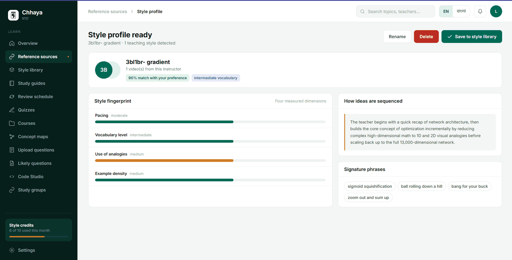

## The problem

Every student has one teacher whose explanations just land, but that teacher isn't there for every topic. Generic AI study tools answer in a generic voice. They can't teach a new topic the way a specific teacher would, and they can't tell you which of several lecture series suits how you learn. Coding practice and exam preparation are also usually disconnected from what you've actually been studying.

## Features

The project has 3 modules and 16 functional requirements, four per member.

### 🎙️ Teaching style and study material
- **Reference sources → teaching-style profiles.** Add a YouTube video or playlist. Chhaya fetches and cleans the transcript, then uses Gemini to build a reusable style profile covering pacing, vocabulary, analogies, example density, concept sequencing and signature phrases. Playlists with several instructors produce one profile per instructor.
- **Style Library.** Teaching-style and coding-style profiles in one place. Coding styles are extracted by rule-based analysis (regex and line counting, no AI). A *preference fingerprint* gives each profile a live match score against how you actually study.
- **Study guides in a teacher's style.** Choose quick revision, standard chapter or deep dive. Optionally add a formula sheet for STEM topics and a Bangla version. Guides can be exported to PDF.
- **Voice narration.** Notes and guides are read aloud with Edge TTS, using a voice and speaking rate matched to the teacher profile. Audio is cached for reuse.
- **Courses → chapters → notes.** Typed or uploaded notes, highlights that persist across sessions, and a glossary for each chapter.
- **Concept-map recall game.** Fill-in-the-blank games built locally with NLTK, no AI needed.

### 📝 Exam preparation and progress
- **Past exam papers with OCR.** Upload a PDF or image. The OCR.Space API extracts the text, and the original file and extracted text are shown side by side.
- **Likely exam questions.** Gemini analyses selected past papers: question types, how marks are distributed, sections, phrasing style and topic coverage. It then predicts 3–20 practice questions in the same format.
- **Quizzes from your notes.** Gemini generates the questions. Timed attempts use a deadline kept on the server, with auto-submit when time runs out. Gemini grades typed answers, and the backend calculates the final score and the retake status.
- **Spaced-repetition review schedule.** Uses the SM-2 algorithm with Again / Hard / Good / Easy ratings, and sends email reminders through the Resend API.
- **Learning analytics dashboard.** Sessions, study time and guide views, with week-over-week trends and 14-day charts.

### 💻 Code Studio
- **Code converter.** Translate between Python, Java, C++, JavaScript and C. Clicking a line highlights the matching lines on the other side. You can apply a saved coding style.
- **Solve from a description**, and **visualize** a run as a step-by-step trace of variable values.
- **Practice bank.** Problems come from a public LeetCode dataset on Kaggle, refreshed weekly. Gemini recommends problems based on your saved code, judges your answer, and estimates time and space complexity. The server keeps the timer. A practice dashboard shows your progress and a ranking.

### 👥 Collaboration
- **Study groups.** Create a group, invite students by email, send and answer join requests, accept or reject invitations, and delete a group.
- **Private group discussion.** Messages are visible only to members, and any member can pin or unpin a message.

## Screenshots

### Platform tour

| | |
|---|---|
| 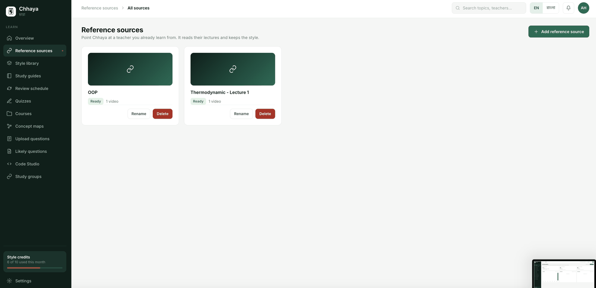<br><sub>Reference sources (YouTube lectures)</sub> | 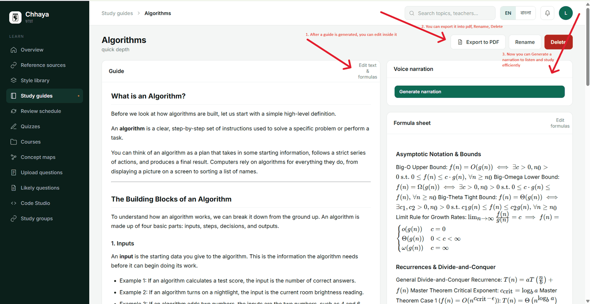<br><sub>Generated study guide with formula sheet and voice narration</sub> |
| 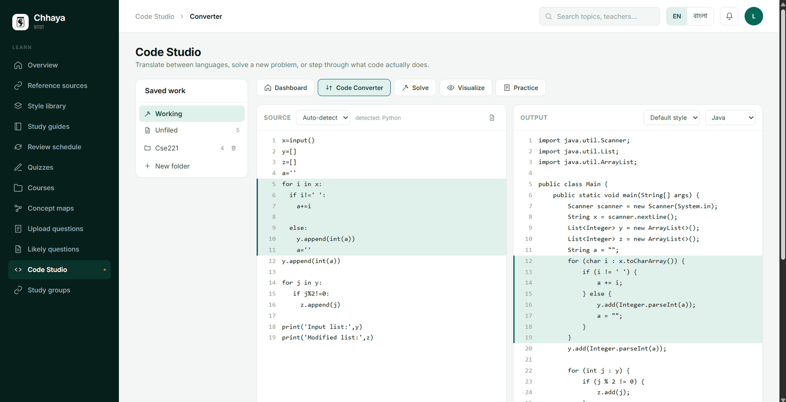<br><sub>Code Studio: Python → Java with line mapping</sub> | 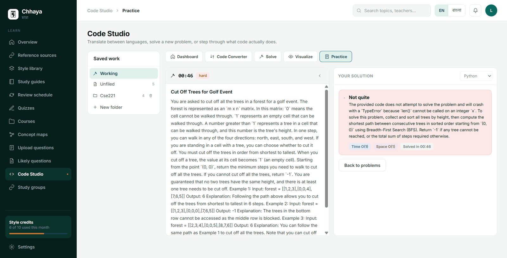<br><sub>Code practice: AI feedback with time and space complexity</sub> |
| 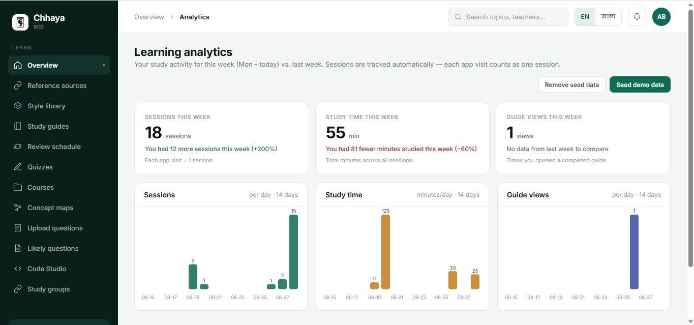<br><sub>Learning analytics dashboard</sub> | 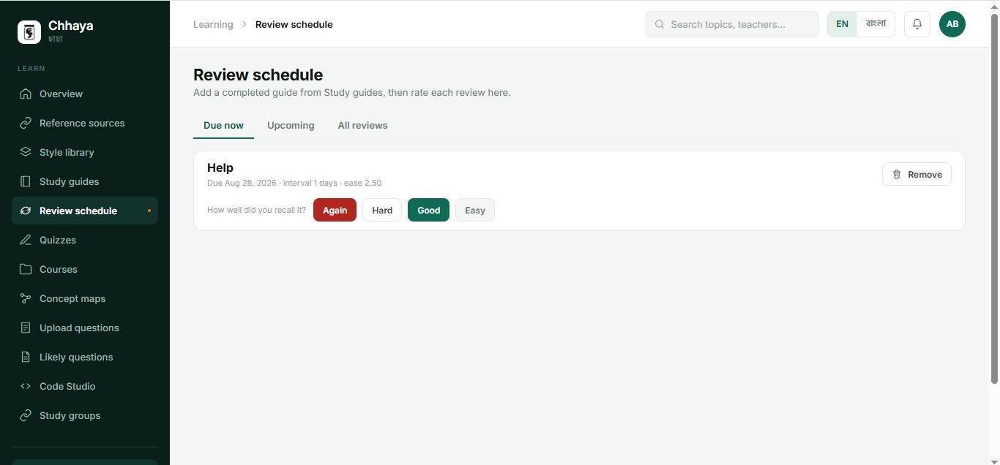<br><sub>Spaced-repetition review schedule</sub> |
| 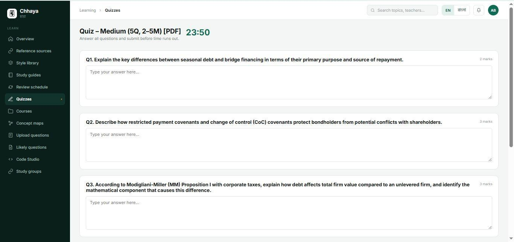<br><sub>Timed quiz session</sub> | 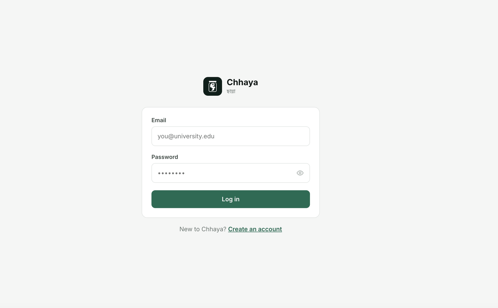<br><sub>Login</sub> |

### Exam papers and likely questions

| | |
|---|---|
| 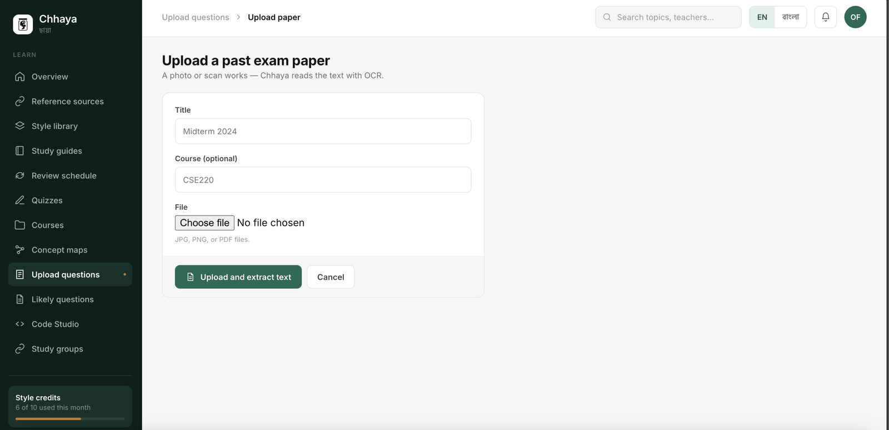<br><sub>Upload a past exam paper</sub> | 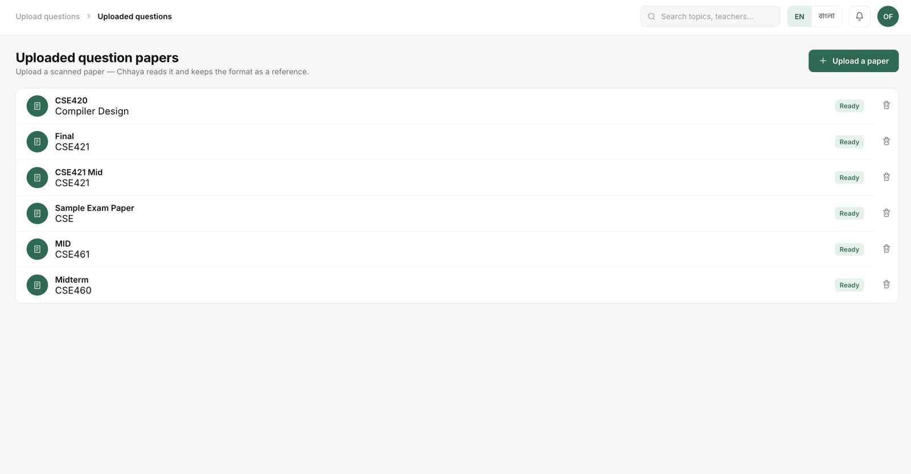<br><sub>Uploaded papers with OCR status</sub> |
| 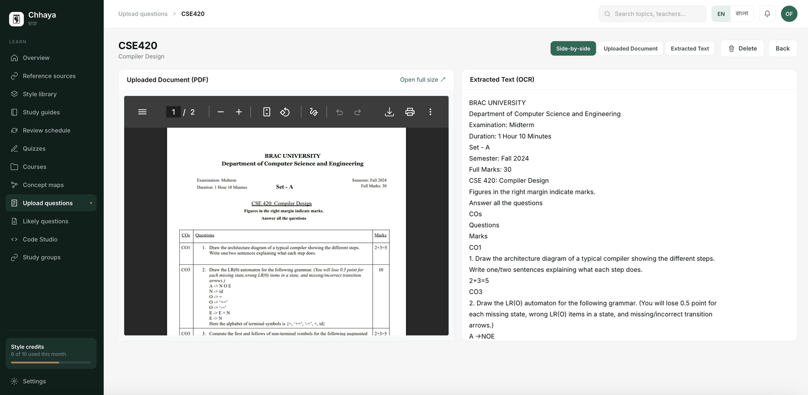<br><sub>Original PDF and extracted OCR text, side by side</sub> | 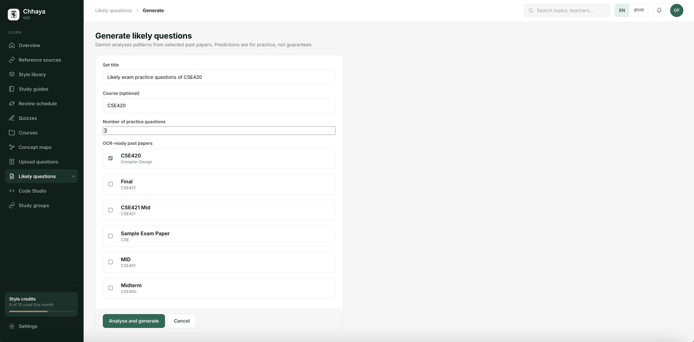<br><sub>Choose OCR-ready papers and number of questions</sub> |

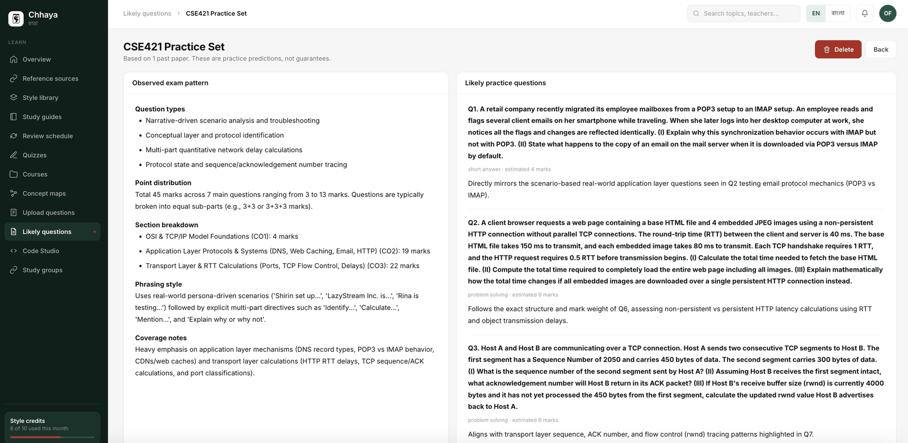
<sub>Gemini's analysis of the exam pattern (left) and the predicted practice questions (right)</sub>

### Study groups

| | |
|---|---|
| 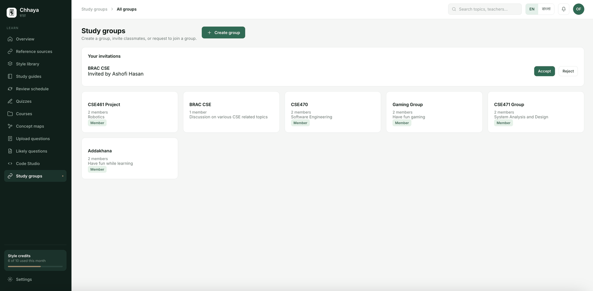<br><sub>All groups and pending invitations</sub> | 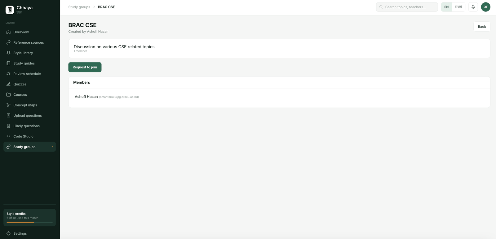<br><sub>Request to join a group</sub> |
| 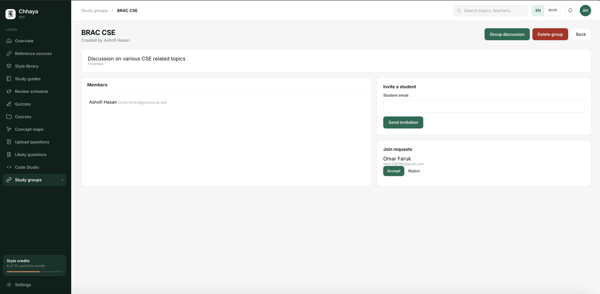<br><sub>Creator view: invite by email, accept or reject requests</sub> | 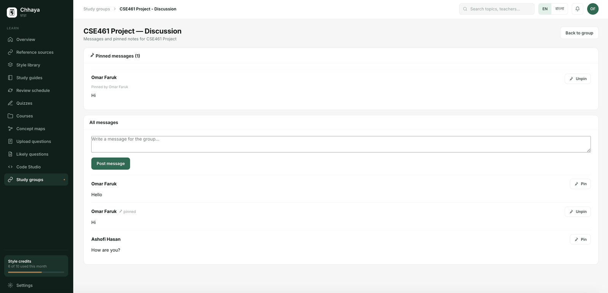<br><sub>Group discussion with pinned messages</sub> |

## Tech stack

| Layer | Technology |
|---|---|
| Frontend | React 19, Vite, React Router, Axios, react-markdown and KaTeX (math), custom CSS, English / বাংলা UI |
| Backend | Python 3.10, FastAPI, Pydantic v2, raw SQL with psycopg 3 and a connection pool (no ORM) |
| Database | PostgreSQL, 34 tables, schema in [`chhaya-backend/sql/schema.sql`](chhaya-backend/sql/schema.sql) |
| Auth | JWT (PyJWT), bcrypt password hashing |
| AI and external APIs | Google Gemini (`google-genai`), OCR.Space, Edge TTS, youtube-transcript-api and yt-dlp, Kaggle (practice bank), Resend (email) |
| Local NLP | NLTK (concept maps, glossary), Python `ast` |
| Deployment | Vercel (frontend), Render (API), Neon (PostgreSQL) |

### Architecture

The backend uses the same layered pattern for every feature:

```
api/v1/endpoints  →  services  →  repositories  →  PostgreSQL
   (routers)        (business      (raw SQL, shared
                     logic, AI)     CRUD base class)
```

Features that don't need AI work without any API keys: coding-style extraction, concept maps, the dashboards and the preference fingerprint. Features that do need AI return clearly labelled mock output when no key is set, so the app runs end to end without any keys.

## Running locally

**Prerequisites:** Python 3.10+, Node.js 18+, PostgreSQL.

### Backend
```bash
cd chhaya-backend
python -m venv venv
source venv/bin/activate              # Windows: .\venv\Scripts\Activate.ps1
pip install -r requirements.txt
cp .env.example .env                  # set DATABASE_URL and JWT_SECRET_KEY; add API keys if you have them

createdb chhaya
psql -U postgres -d chhaya -f sql/schema.sql

uvicorn app.main:app --reload --port 8000
```
Interactive API docs are at **http://localhost:8000/docs**.

Optional keys in `.env`:
- `GEMINI_API_KEY`: AI features
- `OCR_SPACE_API_KEY`: exam-paper OCR, with a free key from [ocr.space](https://ocr.space/ocrapi)
- `RESEND_API_KEY`: review reminder emails
- a Kaggle token in `~/.kaggle/kaggle.json`: the practice problem bank, which imports itself on first startup

### Frontend
```bash
cd chhaya-frontend
npm install
cp .env.example .env                  # VITE_API_BASE_URL=http://localhost:8000/api/v1
npm run dev
```
Open **http://localhost:5173**.

[`chhaya-backend/README.md`](chhaya-backend/README.md) and [`chhaya-frontend/README.md`](chhaya-frontend/README.md) have more detail, and [`render.yaml`](render.yaml) describes the Render deployment.

## Team and contributions

| Member | Functional requirements |
|---|---|
| **Md Mahidad Hossain** | Reference sources and teaching-style extraction · Style Library and preference fingerprint · Code converter and problem solver · Code Studio folders, Kaggle practice bank, AI recommendations, judging and practice dashboard |
| **Lamia Salsabil Mim** | Study guides in a teacher's style (formula sheet, Bangla version) · Courses, chapters, notes and highlights · Teacher-matched voice narration (Edge TTS) · Concept-map recall game (NLTK) |
| **Omar Faruk** | **Past exam papers:** upload, OCR.Space text extraction, side-by-side viewer, delete. **Likely exam questions:** Gemini pattern analysis and predicted questions. **Study groups:** create, invite, join requests, accept or reject, delete. **Group discussion:** members-only messaging with pin and unpin. |
| **Amiyo Bhowmik** | Learning analytics dashboard · SM-2 spaced-repetition review schedule with email reminders (Resend) · Quiz generation from notes with a server-side timer · AI quiz grading, scoring and retake status |

The full requirement descriptions are in [`docs/Functional_Requirements.pdf`](docs/Functional_Requirements.pdf), and individual contributions are in the [project report](docs/Project_Report.pdf).

## Project documents

| Document | Description |
|---|---|
| [Project report](docs/Project_Report.pdf) | System request, requirements, backend and frontend development, UI design, user manual, performance and network analysis, individual contributions |
| [Functional requirements](docs/Functional_Requirements.pdf) | All 16 requirements by module and member |
| [Figma UI design: exam papers and likely questions](docs/assignments/Figma_UI_Design_Omar_Faruk.pdf) | Lab assignment 2 (Omar Faruk), with [Figma file](https://www.figma.com/design/gHBA1qmxSevF6WgYk7sHYf/Assignment-2?node-id=0-1&t=rfOiQ6bXZK0a303q-1) and [prototype](https://www.figma.com/proto/gHBA1qmxSevF6WgYk7sHYf/Assignment-2?node-id=0-1&t=rfOiQ6bXZK0a303q-1) |
| [Postman API collection: exam papers](docs/assignments/Postman_API_Collection_Omar_Faruk.pdf) | Lab assignment 3 (Omar Faruk): `GET/POST /api/v1/exam-papers`, `GET/DELETE /api/v1/exam-papers/{id}` |

## License

All rights reserved.
